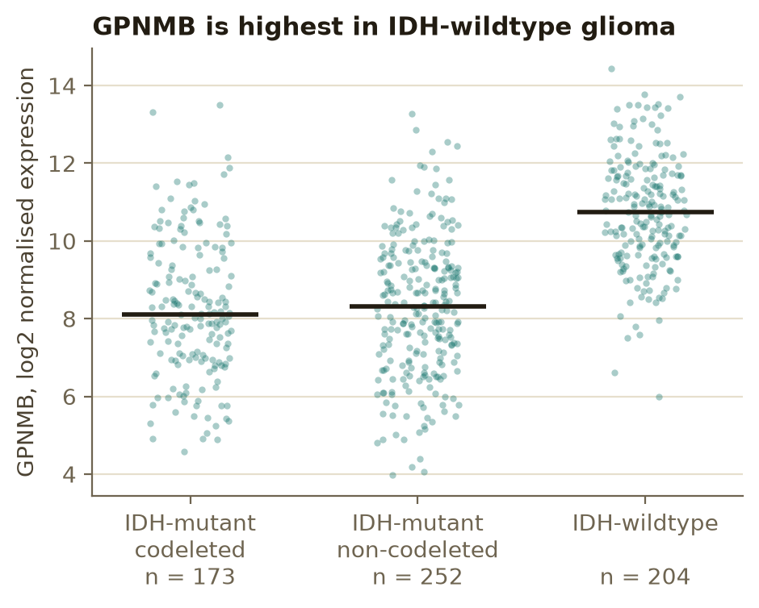
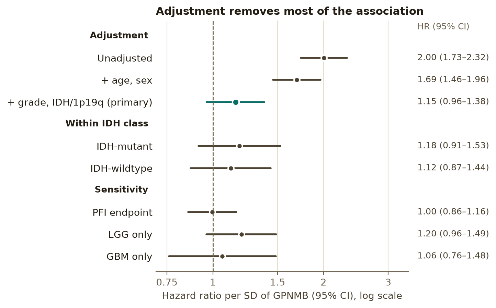
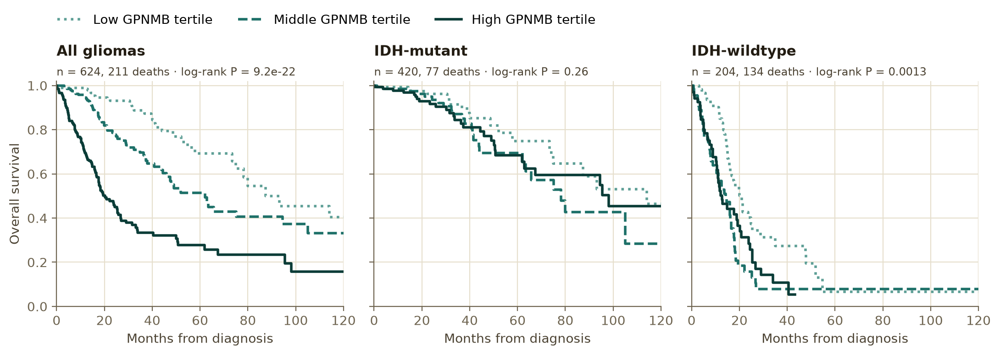

# GPNMB and survival in diffuse glioma: a confounding-aware Cox analysis

Is high **GPNMB** expression an independent marker of poor survival in diffuse glioma, or does it only track tumour grade and IDH status? This project answers that with a pre-specified Cox proportional hazards analysis of open-access TCGA data.

**Short answer:** GPNMB is strongly associated with survival on its own (HR 2.00 per SD), but almost all of that association is explained by grade and IDH/1p19q status (adjusted HR 1.15, 95% CI 0.96–1.38, P = 0.12). It adds essentially nothing to a clinical-molecular model (optimism-corrected gain in Harrell's C: 0.0009).

It complements my Parkinson's disease work on GPNMB (Mendelian randomisation, colocalisation and snRNA-seq), applying the same target to a different question: prognosis rather than causality.

## Data

All inputs are open access (no data use agreement) and come from the TCGA Pan-Cancer Atlas via the UCSC Xena hub:

| Input | Source |
|---|---|
| GPNMB expression | `EB++AdjustPANCAN_IlluminaHiSeq_RNASeqV2.geneExp.xena`: batch-corrected RNA-seq, log2(x+1) |
| Survival endpoints, age, sex, grade | TCGA Clinical Data Resource (Liu et al., *Cell* 2018) |
| IDH and 1p/19q status | Ceccarelli et al. (*Cell* 2016) glioma clusters, mapped to molecular class |

Ceccarelli et al. split gliomas by IDH status before clustering, so each cluster maps to one class: Codel → IDH-mutant codeleted; G-CIMP-high/low → IDH-mutant non-codeleted; Classic-like, Mesenchymal-like, LGm6-GBM and PA-like → IDH-wildtype. GBM has no recorded grade in TCGA-CDR and is coded WHO grade 4.

**Cohort:** 668 patients with a primary tumour RNA-seq sample (515 LGG, 153 GBM; most TCGA GBM were profiled on arrays, not RNA-seq). The primary complete-case analysis set is **624 patients with 211 deaths**.

## Pre-specified analysis

The plan was written into `config.yaml` before any survival association was examined:

- **Endpoint:** overall survival (progression-free interval as sensitivity).
- **Exposure:** GPNMB log2 expression, standardised (HR per SD).
- **Primary model:** Cox, adjusted for age (per 10 years), sex, WHO grade (2/3/4) and molecular class (IDH-mutant codeleted / non-codeleted / IDH-wildtype).
- **Model sequence:** unadjusted → age and sex → primary, to show how adjustment changes the estimate.
- **Assumptions:** Schoenfeld-residual test of proportional hazards; a violating categorical covariate is stratified, not dropped. Spline (3 df) vs linear GPNMB by likelihood-ratio test.
- **Effect modification:** GPNMB × IDH-wildtype interaction, and estimates within IDH-mutant and IDH-wildtype.
- **Discrimination:** gain in Harrell's C from adding GPNMB, optimism-corrected with 1,000 bootstrap resamples (Harrell's method).
- **Kaplan–Meier:** GPNMB tertiles, descriptive only. No data-driven "optimal" cut-point.
- **Sensitivity:** PFI endpoint; LGG only; GBM only.

## Results



GPNMB is higher in IDH-wildtype tumours (median 10.7 vs 8.1–8.3 log2 units), which have much worse survival. That makes IDH status a confounder.



| Model | HR per SD (95% CI) | P |
|---|---|---:|
| Unadjusted | 2.00 (1.73–2.32) | 4 × 10⁻²¹ |
| + age, sex | 1.69 (1.46–1.96) | 4 × 10⁻¹² |
| **+ grade, IDH/1p19q (primary)** | **1.15 (0.96–1.38)** | **0.12** |
| Within IDH-mutant | 1.18 (0.91–1.53) | 0.20 |
| Within IDH-wildtype | 1.12 (0.87–1.44) | 0.38 |
| PFI endpoint | 1.00 (0.86–1.16) | 0.96 |
| LGG only | 1.20 (0.96–1.49) | 0.11 |
| GBM only | 1.06 (0.76–1.48) | 0.73 |

- **Proportional hazards:** no violation (smallest Schoenfeld P = 0.18), so no stratification was needed.
- **Non-linearity:** none detected (spline vs linear, χ² = 3.8, 2 df, P = 0.15).
- **Interaction with IDH status:** none (χ² = 0.002, 1 df, P = 0.97).
- **Discrimination:** Harrell's C 0.864 without GPNMB, 0.865 with it; optimism-corrected gain 0.0009 (998 of 1,000 resamples converged).



Tertiles are cut within each panel. The huge separation across all gliomas (log-rank P = 9 × 10⁻²²) shrinks within IDH-mutant tumours (P = 0.26). Within IDH-wildtype the unadjusted curves still separate (P = 0.001), but that group mixes grade 2–3 tumours with GBM: the low-GPNMB third has 42 of 68 grade 2–3 tumours, against 26 of 68 in each of the other thirds. Once grade and age are adjusted for, the IDH-wildtype HR is 1.12 (0.87–1.44). Unadjusted Kaplan–Meier curves alone would have overstated the evidence.

## What this shows, and what it doesn't

**Supports:** GPNMB's crude prognostic association in glioma is largely confounding by grade and IDH/1p19q status, and it adds little prognostic information beyond them in this cohort.

**Does not show:** that GPNMB has no biological role in glioma; the confidence intervals still allow a modest independent effect (up to about 1.4 per SD). Bulk expression mixes tumour and microenvironment (GPNMB is high in myeloid cells), and the GBM subset is small (117 in the complete-case set).

## Run it

```bash
python -m pip install -r requirements.txt
make all     # download (~4 MB), build cohort, fit models (~5 min, mostly bootstrap), draw figures
make test
```

Or step by step: `scripts/00_download.py`, `01_build_cohort.py`, `02_survival.py`, `03_figures.py` (run from the repository root with `PYTHONPATH=.`).

Outputs are in `results/tables/` (model sequence, primary model, PH tests, subgroup and sensitivity estimates, `summary.json`) and `results/figures/`.
